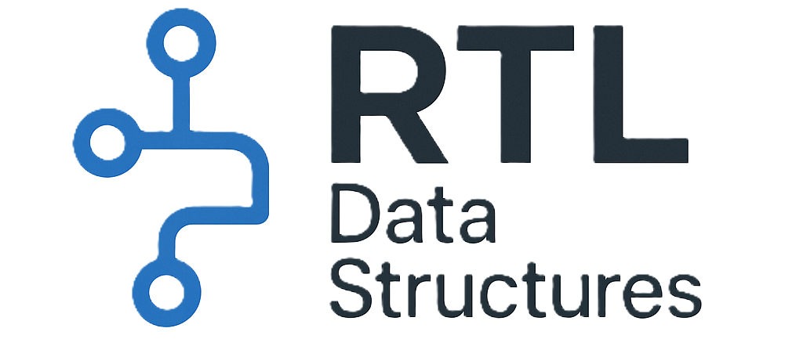

----------


<p align="center">
  
</p>

<div align="center">
  


  
</div>

# RTLStructLib
Highly optimized (trying my best), synthesizable data structures module/IP library for hardware design

### Overview
RTLStructlib is an open-source project providing a collection of synthesizable RTL data structures implemented at the Register-Transfer Level (RTL). These modules are designed for high performance, scalability, and ease of integration into digital systems, serving as a standard library for FPGA and ASIC engineers.
By using these pre-built RTL modules, engineers can accelerate development, reduce verification time, and focus on higher-level system design.

### Features
✅ Synthesizable, Optimized, Modular and Reusable <br>
✅ Fully parameterized <br>
✅ Comprehensive verification sequence and testbench <br>
✅ Verification IP (VIP) <br>
✅ Open-source and community-driven <br>

### Supported Data Structures
- FIFO (First-In-First-Out) Queue – Parameterized depth, support for synchronous & asynchronous modes <br>
- LIFO (Last-In-First-Out) Stack – Configurable width and depth <br>
- Singly Linked List – Efficient memory utilization, dynamic data handling <br>
- Doubly Linked List – Bi-directional traversal support <br>
- Table - Indexed storage mechanism, similar to a register file, enabling rapid direct access and simultaneous read write access to data without hashing. <br>
- List - Support sorting, find_index, delete, insert operations <br>
- Circular Linked List - Bidirectional circular traversal, address/index operations, and bounded value search. <br>
- [Bitmap Free List](Bitmap_Free_List/README.md) - Lowest-free-ID allocation, checked release, and same-cycle slot reuse. <br>
- [Priority Queue](Priority_Queue/README.md) - Bounded binary heap with min/max priority, push/pop/peek, and request/response backpressure. <br>
- Hash Table – Optimized for high-speed lookups, currently only supports modulus hashing and simple multi-staged chaining to handle collision <br>
- Dual Edge Flip Flop - Double input and output rate structure which can latch data on both rising and falling edge <br> 
- Systolic Array - Parameterized matrix multiplication with weight-stationary PEs, tiled reduction, and output backpressure. <br>
- Binary Tree (WIP) – Fundamental structure for hierarchical data organization <br>
- AVL Tree (WIP) – Self-balancing binary search tree for efficient operations <br>
- And More and More and More (WIP)

### License
This project is licensed under the MIT License – see the LICENSE file for details.

### Getting Started
1️⃣ Install required tools and package 
``` bash  
sudo apt install make git iverilog yosys gtkwave
pip install cocotb
pip install cocotb-bus
```

1️⃣ Clone the Repository <br> 
``` bash  
git clone https://github.com/Weiyet/RTLStructLib.git
```

2️⃣ Directory Structure of Each Data Structure Module <br> 
````
📦 <data structure>/          # Data Structure Module as folder name <br>
 ├── 📃 readme.md              # Documentation of waveform, modules IOs, parameter. <br>
 ├── 📂 src/                   # RTL Source Code <br>
 │    ├── 📃 rtl_list.f        # RTL file list required for the modules <br>    
 ├── 📂 tb/                    # Testbench Directory <br>
 │    ├── 📂 cocotb/           # Python Cocotb (Non-UVM) Testbench <br>
 │    ├── 📂 sv/               # SystemVerilog (Non-UVM) Testbench <br>   
 ├── 📂 vip/                   # Verification IP <br>
 │    ├── 📂 uvm/              # system verilog UVM <br>
 |    |    ├── 📃 readme.md    # Documentation of VIP <br>
 │    ├── 📂 pyuvm/            # python UVM <br>
 |    |    ├── 📃 readme.md    # Documentation of VIP <br>
 ````
2️⃣ RTL Simulation and Verification
``` bash  
# Run from the repository root; replace FIFO with the desired block.
make -C FIFO/tb/sv sim      # SystemVerilog RTL testbench
make -C FIFO/tb/cocotb      # Python cocotb RTL testbench
```     
3️⃣ Synthesis and Netlist simulation
``` bash  
# Run from the repository root.
make -C FIFO/tb/sv synth        # Synthesize RTL to a Xilinx-mapped netlist
make -C FIFO/tb/sv netlist_sim  # Synthesize, then run the SV TB on that netlist
```
Both targets belong to the block's `tb/sv/Makefile`, which includes
`Utils/tb/sv/Makefile`. If already inside `FIFO/tb/sv`, use `make synth`
or `make netlist_sim` without `-C`.

`netlist_sim` performs functional gate-level simulation (GLS) with Icarus and
the selected technology's cell models (Xilinx by default); it does not include
SDF timing annotation.
It synthesizes again by default, so running `synth` first is optional.
Use `make -C FIFO/tb/sv netlist_sim SKIP_SYNTH=1` only to reuse an existing
netlist built from the same RTL, technology and parameter values. Xilinx outputs
default to `FIFO/tb/sv/sim_build/`; SKY130 uses its `sky130/` subdirectory.

4️⃣ To view VCD waveform 
``` bash  
gtkwave <waveform.vcd>
```
5️⃣ Integrate to your project
Include file list <Data structure>/src/rtl_list.f to your simulation or project.

### Local Verification

Run each block's benches from Linux/WSL using its own Makefile, for example
`make -C FIFO/tb/sv sim` or `make -C FIFO/tb/cocotb`.
See the block's README for supported parameters and verification scope.
The standalone cocotb benches were validated with Python 3.10,
`cocotb==1.8.1` and `find-libpython==0.3.1`.

### Shared Makefiles

Each bench keeps its RTL sources, top module and parameter defaults locally,
then includes one shared rule file:

| Bench | Include from its local Makefile |
|-------|---------------------------------|
| `tb/sv` | `include ../../../Utils/tb/sv/Makefile` |
| `tb/cocotb` | `include ../../../Utils/tb/cocotb/Makefile` |
| `vip/pyuvm` | `include ../../../Utils/vip/pyuvm/Makefile` |

The TB and pyUVM rules default to Icarus. SV UVM uses the separate Verilator
rules in `Utils/vip/Makefile`. pyUVM reuses the cocotb engine and adds the
repository to `PYTHONPATH`; install the environment's Python dependencies first.

```bash
make -C FIFO/tb/sv sim DEPTH=8 SEED=123 WAVES=1
make -C FIFO/tb/cocotb DEPTH=8 SEED=123 WAVES=1
make -C Priority_Queue/vip/pyuvm DEPTH=5 MIN_FIRST=0 SEED=123
```

`WAVES=0` is the default. SV writes `sim_build/sim.vcd`; Icarus/cocotb
writes `sim_build/<TOPLEVEL>.fst`. Override `SIM_BUILD` to isolate builds,
or run `make clean` before changing elaboration parameters. SV synthesis
also writes under `SIM_BUILD`; `NETLIST` and `SYNTH_LOG` can override those paths.
`netlist_sim` is supported by FIFO, LIFO, Table, Hash Table, Priority Queue,
Bitmap Free List, Singly Linked List and Doubly Linked List. Unsupported benches fail explicitly;
the old automatic Xilinx library downloads have been removed.

The default Python target, `check`, validates cocotb XML and rejects failed,
skipped or empty test runs. The eight legacy pyUVM environments other than
Priority Queue still have Python import failures; sharing build rules does
not make those VIP suites functionally verified. Use their standalone TBs.

### SKY130 Synthesis and Functional GLS

The shared SV TB rules support `TECH=xilinx` (default) and `TECH=sky130`.
SKY130 maps to the **sky130_fd_sc_hd** standard-cell library using Yosys
`dfflibmap` and `abc -liberty`, followed by tie-cell mapping and checks for
unmapped internal cells. RAM arrays use generic synthesis mapping to registers
and logic; SRAM macros are not integrated.

Use an external open_pdks-compatible installation with this layout:

```text
$PDK_ROOT/sky130A/libs.ref/sky130_fd_sc_hd/
  lib/sky130_fd_sc_hd__tt_025C_1v80.lib
  verilog/primitives.v
  verilog/sky130_fd_sc_hd.v
```

From the repository root:

```sh
export PDK_ROOT=/path/to/pdks
make -C Bitmap_Free_List/tb/sv synth TECH=sky130 CAPACITY=5
make -C Bitmap_Free_List/tb/sv netlist_sim TECH=sky130 CAPACITY=5 SEED=123
```

`netlist_sim` includes synthesis. `PDK` defaults to `sky130A` and
`SKY130_CORNER` to `tt_025C_1v80` (typical, 25 C, 1.8 V).
For another installation layout, override `SKY130_LIB_DIR`, or specify
`SKY130_LIBERTY=/absolute/path/cells.lib` and
`SKY130_MODELS="/absolute/path/primitives.v /absolute/path/cells.v"`.
Liberty files must be uncompressed; the models must match the selected library.
Only synthesis requires Liberty; GLS reusing a netlist requires the Verilog models.

SKY130 outputs default to the bench's `sim_build/sky130/`. Use a distinct
`SIM_BUILD` when retaining different capacities or corners. The synthesis log
contains cell counts and Liberty-based cell area. GLS defines `FUNCTIONAL`
and an empty `UNIT_DELAY`, without explicit power ports or SDF annotation.
Changing the Liberty corner changes synthesis data, not functional GLS delays.
This flow does not perform placement, routing, STA, or physical sign-off.

Library files are not bundled or automatically downloaded. Validation used the
[SiliconCompiler lambdapdk SKY130 distribution](https://github.com/siliconcompiler/lambdapdk/tree/51ac6529207ce9b161a637fe596133a8b111928a/lambdapdk/sky130)
at the pinned revision in that link, with its HD TT Liberty and
`primitives.v`/`sky130_fd_sc_hd.v` models. Keep PDKs and local validation
artifacts outside tracked source directories.

Validated with Yosys 0.9 and Icarus: 14 SKY130 GLS runs (seeds 123/19)
cover Bitmap Free List capacities 1/5/33, synchronous FIFO depth 3,
asynchronous FIFO depth 4, LIFO depth 3, and Table size 4. Four Xilinx GLS
regressions and the default RTL simulation also passed. Missing Liberty,
missing models, unsupported technology, missing reused netlist, and watchdog
checks each failed as expected. Other modules/corners are not yet validated
for this SKY130 flow.

### Integration Changes Since v1.2

- FIFO defaults to depth 16; asynchronous depths must be powers of two. Full/empty
  both assert during reset and local reset release to block traffic. See [FIFO](FIFO/README.md).
- Table defines write-first reads and highest-port write priority. Single-entry
  tables use a one-bit address; invalid reads return zero. See [Table](Table/README.md).
- Hash Table captures requests, updates duplicate keys in place, and preserves
  neighboring entries on deletion. Its count port now represents the full bucket
  capacity (three bits for capacity four). See [Hash Table](Hash_Table/README.md).

### Work in Progress/Future Works 🚀
🔹 Implementing Hash Binary Tree, AVL Tree and more and more <br>
🔹 Improving performance & adding more use cases <br>
🔹 Study research paper and implement more hardware oriented algorithm or data streamline for HW data structure <br>

### Disclaimer 
Hardware is often highly customized — these modules are designed as references, and you're encouraged to tweak them as needed (e.g., swap registers with RAM, adjust logic latency based on your STA, use content addressable RAM instead of RTL hash table).
<!--stackedit_data:
eyJoaXN0b3J5IjpbODY5MzUyMjksODY5MzUyMjksLTgwMjc2NT
A4MV19
-->
